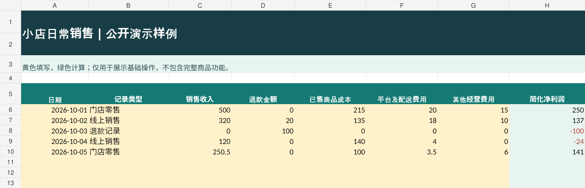

# 轻简表格铺｜小店经营表格工具

这是「轻简表格铺」的公开作品展示项目，主要分享简单实用的 Excel 经营管理工具。项目正在准备正式发布，目前提供可实际使用和检查公式的**免费功能演示版**。

> 本项目由轻简表格铺发起，使用电子表格和 AI 辅助完成制作、检查与演示。公开内容为真实项目示例，不代表已有客户、销售记录或使用人数。

## 一、已经完成的作品

**小店利润小管家（Excel 模板）**

面向小型店铺、个体经营者，帮助整理销售额、退款、商品成本和经营费用，减少手工计算。

正式产品设计包含：
- 每日经营记录与简化净利润计算；
- 退款及已售商品成本等项目；
- 月度经营汇总、渠道对比、年度趋势图；
- 常见录入错误提醒和使用说明。

项目目前处于产品测试与上架准备阶段，尚未宣称完成爱发电正式销售。

## 二、公开演示：可查看、可修改、可验证

[下载免费功能演示 Excel](%E5%B0%8F%E5%BA%97%E7%9B%88%E4%BA%8F%E8%A1%A8_%E5%85%8D%E8%B4%B9%E5%8A%9F%E8%83%BD%E6%BC%94%E7%A4%BA.xlsx)

这份小样包含“先看说明、销售演示、汇总演示”工作表。你可以修改黄色区域的金额，观察自动计算结果是否正确。

**示例：** 销售 500 元、商品成本 215 元、平台及配送费 20 元、其他费用 15 元，没有退款时，简化净利润为 250 元。

免费演示版仅包含基本计算，不包含完整商品的全部功能，也不是正式收费文件。

## 三、我在做什么

- 制作和调整方便普通用户填写的 Excel 模板；
- 检查净利润计算、退款及异常数据等情况；
- 整理新手使用说明、图示和常见问题；
- 根据试用反馈持续改进产品。

四、爱发电创作者主页

轻简表格铺的爱发电主页：

(https://afdian.com/a/qingjianbiaoge?utm_source=copylink&utm_medium=link)

本 GitHub 仓库用于展示「轻简表格铺」制作的 Excel 工具及免费演示作品，与上述爱发电主页由同一创作者维护。
## 五、使用边界

本工具是经营管理用的简化利润估算，不代替正式财务账簿、审计或税务申报。
公开演示数据均为模拟数据，不含个人客户信息。
